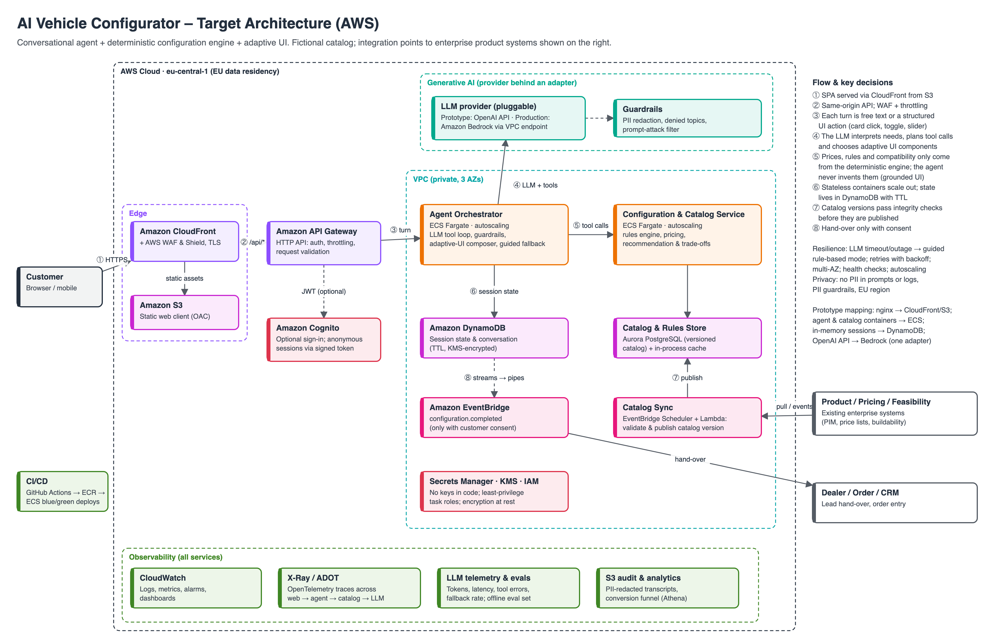

# AI Vehicle Configurator - prototype

A customer describes their needs in plain language. An agent turns them into structured requirements, recommends models with reasons, asks only the questions that change the outcome, and guides the customer to a **valid, explainable configuration**. The chat is paired with **adaptive UI**: model cards, a comfort/sport slider, answer chips, trade-off cards, conflict resolution, option toggles, a comparison table and a configuration summary.

> The product catalog is **fictional**. Model names are for illustration; prices, specs and rules are invented.



---

## Contents

1. [Quick start](#1-quick-start)
2. [Demo script](#2-demo-script-about-5-minutes)
3. [How it works](#3-how-it-works)
4. [Catalog and configuration rules](#4-catalog-and-configuration-rules)
5. [Target architecture (AWS)](#5-target-architecture-aws)
6. [Running tests and local development](#6-running-tests-and-local-development)
7. [API reference](#7-api-reference)
8. [Limitations and next steps](#8-limitations-and-next-steps)

---

## 1. Quick start

**Prerequisites:** Docker with Compose v2. Nothing else is needed.

```bash
git clone https://github.com/BigJalabenjo/ai-vehicle-configurator.git
cd ai-vehicle-configurator
docker compose up --build
```

Open **http://localhost:8080**.

The prototype has two agent modes. The badge in the top-right corner shows which one is active.

| Mode | When | What answers |
|---|---|---|
| **AI agent (OpenAI or Claude)** | `OPENAI_API_KEY` or `ANTHROPIC_API_KEY` is set | An LLM (default `gpt-5.5` or `claude-opus-5-5`) drives the conversation through tool calls into the rules engine |
| **Guided mode (offline)** | No key (default) | A deterministic, rule-based agent uses the *same* tools and UI components |

To enable AI mode, put **one** key in a local `.env` file. `.env` is git-ignored, so keys never enter the repository.

```bash
cp .env.example .env
# edit .env and set OPENAI_API_KEY=... (or ANTHROPIC_API_KEY=...)
docker compose up --build
```

If the LLM is unreachable, rate-limited or out of quota, the app switches to guided mode for that turn and shows a notice, so the journey never dead-ends.

Optional settings (in `.env` or the environment):

| Variable | Default | Meaning |
|---|---|---|
| `LLM_PROVIDER` | `auto` | `auto` (whichever key is set, OpenAI first), `openai` or `anthropic` |
| `AGENT_MODE` | `auto` | `auto` (AI if a key is set), `llm`, or `offline` |
| `LLM_MODEL` | provider default | `gpt-5.5` (OpenAI) or `claude-opus-5-5` (Anthropic); any tool-calling model works |
| `LLM_EFFORT` | unset | Reasoning effort (`low`/`medium`/`high`); leave empty for non-reasoning models |
| `APP_PASSWORD` | unset | Shared access password. When set, visitors must sign in first (see below); unset = open |
| `APP_SECRET` | random | Secret for signing session cookies (`openssl rand -hex 32`); keeps sign-ins valid across restarts |
| `AUTH_TTL_HOURS` | `12` | How long a sign-in lasts |

### Password protection (for publishing)

Set `APP_PASSWORD` (and `APP_SECRET`) in `.env` and restart. Every page then redirects to a sign-in page until the correct password is entered.

* **The password never enters the repository.** It is read from the environment, compared in constant time, and wrong attempts are slowed down. nginx also rate-limits sign-in attempts to 10 per minute per IP.
* **A successful sign-in sets a signed, HTTP-only, `SameSite=Strict` session cookie** valid for `AUTH_TTL_HOURS`. The cookie is marked `Secure` when the app is reached over HTTPS, including behind a TLS proxy that sends `X-Forwarded-Proto`. Changing the password signs everyone out.
* **Protection is enforced twice:** nginx checks the session before serving pages and vehicle photos (`auth_request`), and the agent API rejects unauthenticated calls itself. Only the sign-in page, styles, logo/fonts, `/api/auth/*` and `/api/health` are public.
* **Serve it over HTTPS when you publish** (e.g. behind a reverse proxy or a load balancer with TLS), so the password and cookie are never sent in clear text.

### Chrome extension: open the assistant on bmw.de

[`extensions/chrome`](extensions/chrome) adds an **AI mode** switch to the BMW configurator (`configure.bmw.de/…/configure/…`). Switching it on reveals this app as an overlay on top of the configurator. Set `EMBED_ORIGINS=https://configure.bmw.de` in `.env` so the app may be shown there, then load the folder as an unpacked extension (`chrome://extensions` → Developer mode → Load unpacked). With a local app, Chrome asks once whether the configurator may access your local network; click **Allow**. Details in the [extension README](extensions/chrome/README.md).

## 2. Demo script (about 5 minutes)

This works in either mode. The wording below matches guided mode.

| # | Do this | What it shows |
|---|---|---|
| 1 | Click the first example: *"I need a family car for regular long-distance travel. I prefer electric, need room for three children…EUR 85,000"* | **Understanding.** The "Your needs" panel shows budget, *prefers* electric (a soft preference, not a hard filter), 3 child seats and long trips. "How I interpreted this" lists assumptions, e.g. *3 children → three child seats side by side*. **Recommendations with reasons:** i5 Touring first, then X5 PHEV and 520d. **Trade-offs:** the iX is €1,900 over budget, and the i4 can't fit three child seats. **One focused question** (towing), because the answer changes which models qualify. |
| 2 | Click **Bike carrier** | Requirement updated. Entry prices now include the tow hitch. The next question becomes the comfort/sport **slider**. |
| 3 | **Configure** the i5 Touring | Tow hitch auto-added *"because your requirements need it"*. Option toggles are suggested for long trips and family use, each with a reason. |
| 4 | Toggle **Driving Assistant Professional** | **Dependency:** Parking Assistant Plus is auto-added with an explanation. |
| 5 | Toggle **Travel & Comfort Package**, then type *"add the M Sport package"* | **Conflict:** both packages lock the seat type. Nothing changes silently. A conflict card offers *Add M Sport, remove Travel & Comfort* or *Keep*. |
| 6 | Type *"add rear-seat entertainment"* | **Invalid option:** not offered on the i5. The reply lists models that do offer it. Unavailable options in the side panel are struck through; clicking one gives the same explanation. |
| 7 | Type *"Actually, my budget is 78,000"* | **Graceful revision:** the current configuration is re-checked (€79,350, so €1,350 over), savings are suggested, and alternatives that fit are shown. |
| 8 | Untick the Travel & Comfort Package (now €76,400), then click **Review summary** | **Valid, explained configuration:** a price breakdown where each line says why it's there, a needs check, and the assumptions. |
| 9 | *(Optional)* Click **×** on a requirement chip, or type *"We need 7 seats, must be electric"* | Removing a need re-ranks the models. An impossible combination returns the closest models and the single compromise each one needs. |

## 3. How it works

### Components

```
Browser (vanilla JS SPA)  ──/api──▶  agent service (FastAPI)  ──HTTP──▶  catalog service (FastAPI)
     nginx :8080                       orchestrator                       rules engine, pricing,
                                       ├─ LLM agent (tool loop)           recommender, trade-offs
                                       │   └─ OpenAI | Anthropic adapter
                                       ├─ guided agent (fallback)         catalog.json (validated)
                                       ├─ toolbox (7 tools)
                                       └─ UI component builders
```

Each of the three containers has one job.

* **`services/catalog`**: the stand-in for the brand's product, pricing and rules backends. It is stateless and deterministic, and it is the **single source of truth** for prices, availability and compatibility.
* **`services/agent`**: the backend-for-frontend. It runs the conversation, keeps session state, and builds UI components.
* **`services/web`**: static client behind nginx, which also proxies `/api` so the browser stays same-origin. It sends strict security headers and a CSP.

### Agent design

**Grounding: the LLM decides, the engine computes.** The LLM never produces prices, specs or validity. It calls tools, and the rules engine answers:

| Tool | Purpose |
|---|---|
| `update_requirements` | Merge a validated requirements patch plus assumptions; re-check the current configuration |
| `search_models` | Rank models; return fits, near misses (with the exact violated need) and trade-offs |
| `compare_models` | Side-by-side evaluation |
| `select_model` | Start or switch a configuration. Compatible options carry over; dropped ones are explained; options the needs depend on are added |
| `change_option` | Add or remove an option. Returns `applied`, `conflict` (with resolutions), `rejected` (with alternatives) or `noop` |
| `get_configuration` | Price breakdown, budget, validity, unmet needs, suggestions, savings |
| `show_ui` | Pick adaptive UI components. The backend fills them with catalog data |

`show_ui` is how the agent produces **adaptive UI**. The model chooses *which* component helps, such as a question with chips, the slider, cards, a comparison, trade-offs, toggles or the summary. The backend then populates it from authoritative data, so nothing on screen is model-generated numbers. Conflicts and rejections returned by `change_option` are always rendered as cards, whatever the model writes.

**Focused clarification.** The prompt allows at most one question per turn, and only if the answer changes the recommendation. Topics already asked are tracked in session state and passed to the model, so it doesn't ask twice. Guided mode follows the same policy with a fixed priority: budget → party size → towing → comfort/sport.

**Hard vs. soft requirements.** "I prefer electric" ranks electric models higher. "Must be electric" filters out everything else. When nothing fits, each near miss carries a `relax_patch` (the smallest change to the requirements that would make it fit). These become one-click **trade-off cards**.

**UI actions vs. text.**
* Option toggles are applied by the rules engine directly, with no LLM round-trip, so they're instant and cheap. The LLM is told about them on its next turn.
* Card clicks, the slider, accepting a trade-off and removing a requirement are applied deterministically first, then narrated by the agent.

**LLM integration** (`agent_service/llm_agent.py` + `agent_service/providers/`). The tool loop is provider-neutral and hosted by us. We own the loop because every tool call must go through our rules engine, the loop needs a hard step limit (`LLM_MAX_STEPS`), and state lives in our session store. A small adapter per provider translates requests, messages and errors:
* **OpenAI** (`openai_provider.py`): Chat Completions with function calling; the tool schemas are shared with the Anthropic adapter.
* **Anthropic** (`anthropic_provider.py`): Messages API with tool use, prompt caching of the system prompt, and server-side refusal fallback.
* Typed error handling covers rate limits and quota, auth, 5xx and connection errors. Any failure, a refusal or a content filter triggers the guided-mode fallback.
* Tool inputs are validated with Pydantic, and malformed JSON arguments are caught. Either way the model gets an error result and can correct itself.
* Adding another provider (e.g. Bedrock or Azure OpenAI) means writing one adapter with four methods.

### Error handling and resilience

* **Catalog client:** timeouts, plus retries with exponential backoff on connection errors and 5xx. If it's still down, the API returns `503` with a friendly message, and the UI shows **Retry**.
* **LLM outage, timeout or refusal:** guided mode answers the turn.
* **Input validation:** Pydantic on every request, every action and every tool input. Message length limits, discriminated action types, and range checks (e.g. a slider value must be 0-1).
* **Catalog integrity:** every reference (requires, excludes, includes, groups, availability, standard equipment) is checked at startup. A broken catalog fails fast and is never served.
* **Session handling:** a per-session lock serialises concurrent turns. TTL and LRU eviction bound memory use.

### Security and privacy

* No secrets in the repository. The key is read from the environment by the SDK; `.env` is git-ignored, and `.env.example` documents the variables.
* Containers run as a non-root user. Only the web container exposes a port; agent and catalog are internal to the compose network.
* nginx sends CSP, `X-Frame-Options`, `nosniff` and `no-referrer`. CORS is restricted to the web origin.
* Logs contain metadata only (method, path, status, latency, request ID), never message content. The agent never asks for personal data.

### Observability

* A request ID (`x-request-id`) is generated at nginx and propagated web → agent → catalog. Each service logs one line per request with its latency.
* Each LLM step logs provider, model, stop reason, token usage and latency.
* `GET /api/health` reports catalog reachability and the active mode. Containers have Docker health checks, and Compose starts services in dependency order.

## 4. Catalog and configuration rules

`services/catalog/catalog_service/data/catalog.json` holds 8 models (BEV, PHEV, diesel; estate, SAV, coupé, compact) and 25 options. The catalog is small, but it exercises every rule type:

| Rule | Example |
|---|---|
| Availability by model | Rear-seat entertainment only on iX / X5 / X7; the i4 has no tow hitch |
| `requires` (transitive) | Driving Assistant Pro → Parking Assistant Plus. 21" M wheels → M Sport Package → Sport seats. Third row → 4-zone climate |
| Packages (`includes`) | Travel & Comfort includes Comfort seats, heated steering wheel and sun blinds at no extra cost, and locks them |
| `excludes` | Panoramic roof ✕ roof rails |
| Exclusive groups | Wheels, seats and paint: exactly one each. Audio: at most one |
| Effects on specs | 20"/21" wheels cut electric range by 3% / 6%. Third row adds 2 seats and removes 150 l of boot |
| Requirement-driven options | Towing → tow hitch. 7 seats → third row (with its dependency). Both are included in "from" prices |

**Conflict policy.** A change that would silently undo a customer choice is never applied. Instead the engine returns a `Conflict` with explicit resolutions. Replacing standard equipment, or a direct same-group swap (e.g. 19" → 20" wheels), is applied with a note.

## 5. Target architecture (AWS)

Files: [`docs/architecture/architecture.png`](docs/architecture/architecture.png) and the editable [`architecture.drawio`](docs/architecture/architecture.drawio). Both are generated from [`generate.py`](docs/architecture/generate.py) (`make diagram`). To re-render the PNG, open the SVG in a browser, or run Chrome headless with `--screenshot`.

| Concern | Choice | Why |
|---|---|---|
| Edge | CloudFront + WAF/Shield, S3 for the SPA, API Gateway (throttling, validation, optional Cognito JWT) | Global latency, DDoS and bot protection, rate limits per client |
| Compute | Two ECS Fargate services: agent orchestrator and configuration/catalog service, in private subnets across 3 AZs | Same containers as the prototype. Stateless, so they autoscale independently: LLM-bound vs. CPU-bound |
| LLM | Pluggable provider behind one adapter interface. The prototype calls the OpenAI API (or Anthropic). In production, the preferred option is Amazon Bedrock through a VPC endpoint, in-region, with Bedrock Guardrails; calling OpenAI directly goes through a NAT gateway with an egress allow-list | Data residency, no open internet egress for prompts, PII filtering, prompt-attack filter; the provider can change without touching the agent |
| State | DynamoDB sessions with TTL, KMS-encrypted | Serverless scale. The prototype's `SessionStore` protocol is the seam |
| Product data | Aurora (versioned catalog) fed by a sync job from enterprise PIM, pricing and buildability systems; integrity checks before publish | The rules engine stays deterministic and testable; catalog versions can be rolled back |
| Integration | EventBridge `configuration.completed` (with consent) → dealer, order or CRM systems | Loose coupling; the hand-over is auditable |
| Security | Secrets Manager, KMS, least-privilege IAM task roles, no PII in prompts or logs | Key management; GDPR |
| Observability | CloudWatch, X-Ray/ADOT (OpenTelemetry traces across web → agent → catalog → LLM), LLM telemetry (tokens, latency, tool errors, fallback rate) with an offline eval set, PII-redacted analytics in S3/Athena | Debug the agent like any other distributed system; measure quality over time |
| Resilience | Multi-AZ, health checks, retries with backoff, guided-mode fallback when the LLM is unavailable | The customer can always finish |

## 6. Running tests and local development

The tests need no Docker and no API key. They run the agent against the **real** catalog service in-process.

```bash
make dev-install     # creates .venv with pinned dependencies
make test            # 29 catalog tests + 32 agent tests
```

* **Catalog tests** (`services/catalog/tests`): every rule type, conflicts and resolutions, invalid options, savings, model switching, recommendation ranking, trade-offs for unsatisfiable needs, API error codes, and the catalog integrity check.
* **Agent tests** (`services/agent/tests`):
  * The full demo journey in guided mode.
  * AI mode against scripted fake OpenAI and Anthropic APIs. This covers the tool loop, grounded UI hydration, invalid or malformed tool input returned as errors for self-correction, automatic conflict cards, outage, refusal and content-filter fallback, valid history across turns, and UI actions applied before narration.
  * Provider auto-selection from the configured keys.

**AI quality check** (not part of CI, needs the API key): `make eval` plays short customer conversations against the real model and checks the results with rules, without an AI grader. The four core cases check:

* whether needs were extracted exactly (child seats, long trips, budget, towing weight);
* whether it recommends without asking back when everything was said;
* whether a conflict between two packages is surfaced and the configuration stays valid;
* whether a nonexistent option is declined rather than invented;
* whether every euro amount in a reply exists in the catalog, the returned data or the customer's own words.

**Adversarial cases** try to make the assistant misbehave, and check that it doesn't:

* **prompt injection:** an "admin mode" that sets a fake €1 price;
* **social engineering:** an "employee discount" request;
* **leaking instructions:** asks it to reveal its system prompt and tool definitions;
* **off-topic and harmful:** asks for a scraper for personal data;
* **pressure to break the rules:** a "dealer override" that forces two packages that can't be combined.

Here, numbers the customer typed don't count as known prices, so a "€1" can't pass as one.

A full run costs about US$0.50 and prints the score, token usage and an estimated cost. Cases are in `services/agent/evals/cases.json`. `make eval CASES=adversarial` (or `core`, or case ids) runs part of them, and `LLM_MODEL=gpt-5.4 make eval` compares another model. A `deliberate_failure` case expects 3 child seats although the customer says two, so it always fails. It shows what a failure looks like and only runs when switched on: **Include deliberate failure** in the viewer, or `make eval CASES=deliberate_failure`.

Each run is saved to `services/agent/evals/results/`, which git ignores. `make eval-view` opens a small viewer at http://localhost:8090/viewer/. Its **Run evaluation** button starts a new run with the chosen model, after asking for confirmation. Progress appears live and the result opens when the run is done. The viewer only listens on your own machine and refuses run requests from other websites. It shows:

* the score over all runs and the list of runs;
* the checks per case, with the reason for each failure;
* each conversation, with the cards the AI chose and the final configuration;
* tokens, cost and duration per run and per case.

To run the services without Docker:

```bash
cd services/catalog && ../../.venv/bin/uvicorn catalog_service.main:app --port 8001
cd services/agent && CATALOG_URL=http://localhost:8001 CORS_ORIGINS=http://localhost:5500 ../../.venv/bin/uvicorn agent_service.main:app --port 8000
# serve services/web with any static server that proxies /api to :8000, or just use docker compose
```

CI (`.github/workflows/ci.yml`) runs both test suites, then builds the containers and smoke-tests them.

## 7. API reference

Agent service (through nginx at `http://localhost:8080`):

| Method | Path | Body | Returns |
|---|---|---|---|
| `GET` | `/api/health` | | `{status, catalog, mode}` |
| `POST` | `/api/sessions` | | `{session_id, mode, message, state}` |
| `GET` | `/api/sessions/{id}` | | Transcript and state (used to restore the session after a reload) |
| `POST` | `/api/sessions/{id}/turn` | `{"message": "..."}` or `{"action": {...}}` | `{message: {text, components[]}, state, mode}` |

Action types are `answer`, `select_model`, `set_preference`, `apply_tradeoff`, `change_option`, `remove_requirement` and `request_summary`. See `agent_service/orchestrator.py`.

The catalog service is internal. `GET /v1/catalog`, `POST /v1/recommendations`, `POST /v1/configurations/{view|change|switch-model}`. With the catalog running locally, its OpenAPI docs are at `/docs`.

## 8. Limitations and next steps

* **In-memory sessions.** A restart drops sessions; the client then starts a new one. Next step: a DynamoDB or Redis implementation of `SessionStore`.
* **Guided-mode language understanding is regex-based.** It covers the demo phrasings and common variants, in English only. AI mode handles free language and replies in the customer's language.
* **No streaming.** AI turns take a few seconds. Streaming the text, then appending components, would improve perceived latency.
* **Evaluation is tiny.** `make eval` covers four conversations with rule-based checks. Next steps: more personas and languages, an AI grader for tone and clarity, repeated runs to measure variance, and tracking scores per model and prompt version.
* **Catalog depth.** No trims, engine variants, regional pricing, lead times or images yet; the schema extends naturally.
* **The test suite doesn't call a live LLM**, by design: there are no keys in CI. Live use needs `OPENAI_API_KEY` or `ANTHROPIC_API_KEY`.

---

*Built within the 4-hour timebox with AI-assisted coding (Claude Code).*
